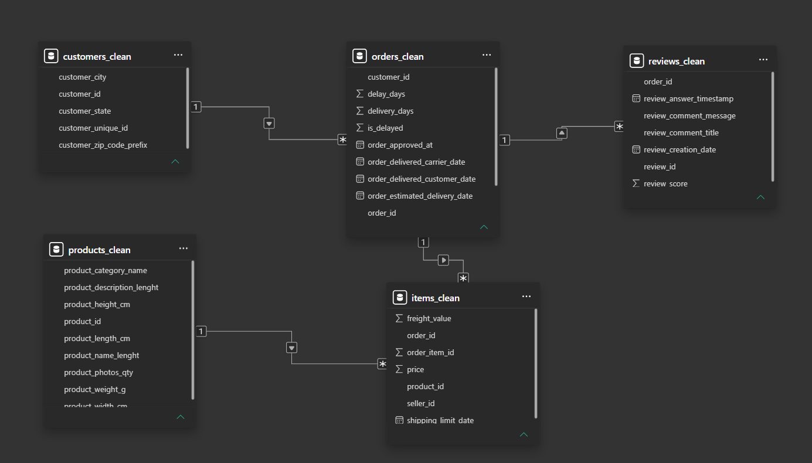
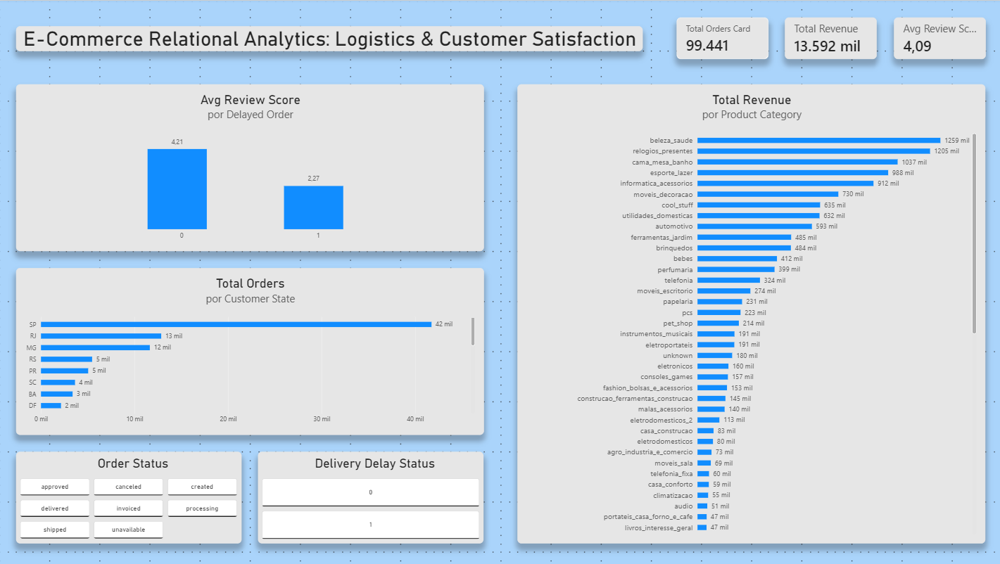

# E-Commerce Relational ETL & Customer Satisfaction Analysis (Olist)

## Project Overview
In real-world e-commerce operations, data is distributed across multiple relational tables rather than a single flat file. In this end-to-end data analytics project, I built a **multi-table ETL pipeline** and relational data model across **~100,000 orders** from the Brazilian E-Commerce Public Dataset (Olist) to evaluate how logistics performance and delivery delays impact customer satisfaction.

**Tools & Technologies Used:**
* **Python (Pandas):** Multi-table extraction, referential integrity checks, deduplication (`reviews`), datetime casting, and logistics feature engineering (`delivery_days`, `delay_days`, `is_delayed`).
* **SQL (SQLite):** Relational database ingestion and multi-table queries combining `INNER JOIN` and `LEFT JOIN` across 4+ tables.
* **Power BI:** Star Schema data modeling (`1:*` single-directional relationships), Power Query regional transformations, DAX measures, and executive dashboard design.

---

## ETL Pipeline & Data Modeling Highlights
1. **Referential Integrity & Deduplication:** Audited primary and foreign keys (`order_id`, `customer_id`, `product_id`) across 5 independent datasets (`orders`, `items`, `customers`, `products`, `reviews`). Deduplicated multi-review orders in Python prior to relational joins to prevent revenue inflation.
2. **Logistics Feature Engineering:** Engineered delivery lead-time and delay variance metrics comparing actual delivery timestamps against estimated delivery dates.
3. **Star Schema Architecture:** Modeled a clean Star Schema in Power BI connecting dimension tables (`customers`, `products`) and order headers (`orders`) to line-item facts (`items`) using single-directional filtering.

---

## Key Analytical Insights
1. **Severe Impact of Delivery Delays on Satisfaction:** Among delivered orders, on-time deliveries achieve an average customer rating of **4.29 stars**, whereas delayed deliveries plummet to **2.27 stars**—a **2.02-star drop** directly tied to logistics execution.
2. **Revenue Concentration by Category & Geography:** Sales volume and revenue (BRL 13.59M across delivered items) are heavily concentrated in top-performing states (led by São Paulo) and core retail categories, providing clear targets for regional logistics optimization.
3. **Category-Level Friction:** Cross-referencing 4 tables (`orders`, `items`, `products`, `reviews`) isolated high-volume product categories experiencing below-average satisfaction due to elevated delay rates.

---

## Data Model & Dashboard Preview

### Star Schema Data Model


### Executive Dashboard


---

## Repository Structure
```text
├── data/
│   ├── raw/                 # Original Olist relational CSV datasets (5 tables)
│   └── processed/           # Cleaned tables & SQLite database (olist_ecommerce.db)
├── notebooks/
│   ├── 01_multi_table_etl.ipynb         # Multi-table cleaning, deduplication & feature engineering
│   └── 02_relational_sql_analysis.ipynb # Relational SQLite setup & multi-table JOIN queries
├── sql/
│   └── ecommerce_relational_queries.sql # Standalone relational SQL queries
├── powerbi/
│   ├── images/                          # Star schema & dashboard screenshots
│   └── ecommerce_star_schema_dashboard.pbix # Power BI report file
└── README.md
```

---

## Author
**Jonathan Ezequiel Ilardi**  
* [LinkedIn](https://linkedin.com/in/jonilardi)
